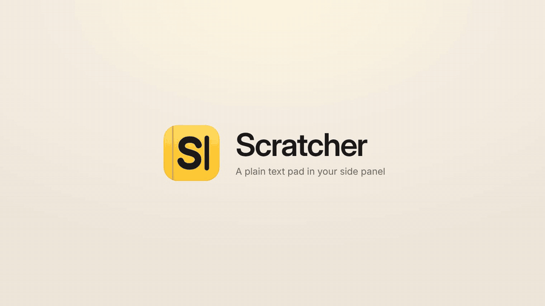

<p align="center">
  <picture>
    <source media="(prefers-color-scheme: dark)" srcset="docs/header-dark.png">
    
  </picture>
</p>

Plain text pads that slide out in your browser's side panel, next to whatever page you're on. Made for [Dia](https://www.diabrowser.com), and works in Chrome and other Chromium browsers too.



[Watch the demo as MP4](docs/scratcher-demo.mp4)

## What it does

- **Opens beside the page.** Click the toolbar button, or press ⌥⇧D (Alt+Shift+D) to open and close it
- **Keeps several pads.** Click + for a new pad, double-click a tab to rename it, × to close it (with Undo). Unnamed pads take their name from the first line
- **Follows you between computers.** Pads sync through your browser's own sync, so they show up wherever you're signed in
- **Takes text from anywhere.** Type, paste, or drag text and text files in. Or select text on any page, right-click and choose Send to Scratcher, and it lands in the open pad
- **Cleans up pastes.** Removes stray spaces, invisible characters and extra blank lines. ⌘⇧V pastes exactly as copied
- **Counts as you go.** Words and characters, including what you've selected
- **Reads aloud.** Reads the selection, or everything if nothing is selected
- **Saves as you type.** Reopens right where you left off, in the pad you had open

## Shortcuts

| Action | Mac | Windows / Linux |
|---|---|---|
| Open or close the panel | ⌥⇧D | Alt+Shift+D |
| Read aloud / stop | ⌘⇧L, Esc to stop | Ctrl+Shift+L |
| Copy all (or the selection) | ⌘⇧↩ | Ctrl+Shift+Enter |
| Clear (with Undo) | ⌘⇧⌫ | Ctrl+Shift+Backspace |
| Paste without cleanup | ⌘⇧V | Ctrl+Shift+V |
| Next or previous pad (with a tab focused) | ← → | ← → |
| Rename or close the focused tab | F2, Delete | F2, Delete |

Change the open shortcut at `dia://extensions/shortcuts` (or `chrome://extensions/shortcuts`).

## Install

1. Download or clone this repo.
2. Open `dia://extensions` (or `chrome://extensions`) and turn on Developer mode.
3. Click Load unpacked and choose this folder.
4. Pin Scratcher to the toolbar.

To update, pull the latest and click the reload arrow on Scratcher's card.

## Sync

Scratcher saves pads in the browser's extension sync storage (`chrome.storage.sync`). With the browser signed in and sync on, the browser carries them to your other computers. There's no Scratcher server.

- Chrome sync gives an extension about 100 KB in all, so pads sync in tab order until that's used. A pad that doesn't fit shows **Not syncing** and stays on the computer where it was written; it syncs again once it's small enough.
- If the same pad is edited on two computers before they catch up, nothing is lost: one version keeps the pad and the other becomes a "(copy)" pad.
- Changes go out a couple of seconds after you stop typing, to stay inside Chrome's write limits.
- Dia and other Chromium browsers may not sync extension storage. Scratcher works the same there; pads just stay on that computer.

## Privacy

Permissions are side panel, storage and the right-click menu. Scratcher can't read the pages you visit; it only gets text you send to it. Your text is kept in the browser and synced only by the browser's own sync. Scratcher makes no network requests. Full [privacy policy](PRIVACY.md).

## Tests

```
node --test test/*.test.js
```

The sync tests run two and three simulated computers against Chrome sync's quotas, including offline edits.

## Credit

Saving approach adapted from [NewTabPad](https://github.com/s-wool/NewTabPad) by Norikazu Kato. MIT licensed, see [LICENSE](LICENSE).
